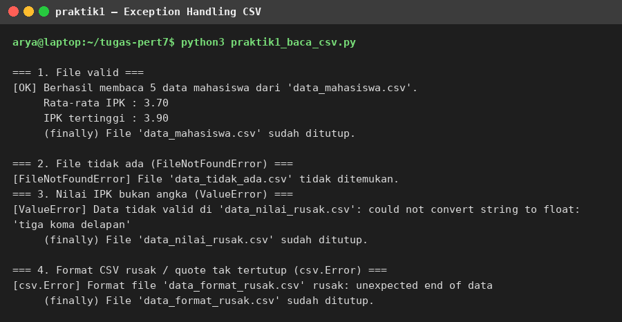
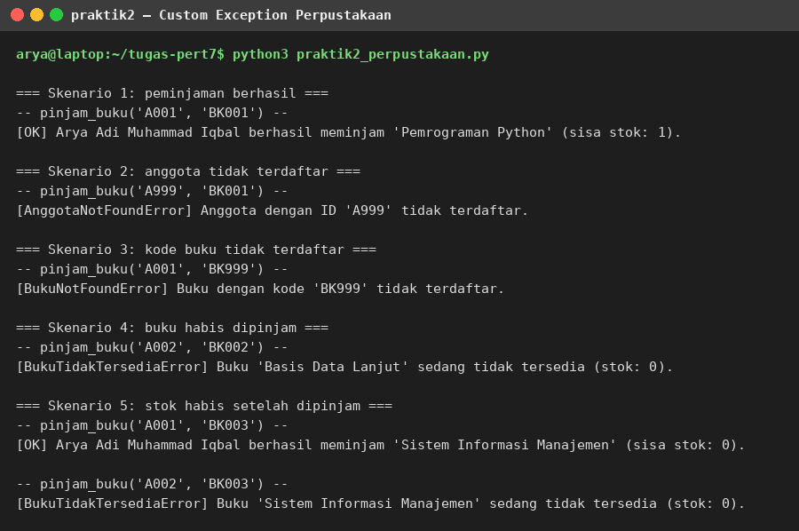
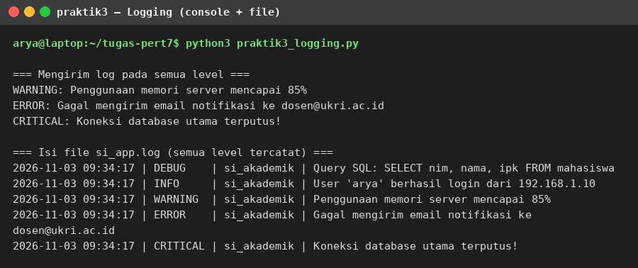
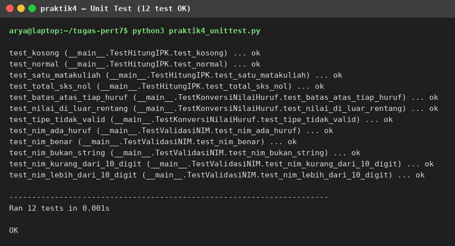
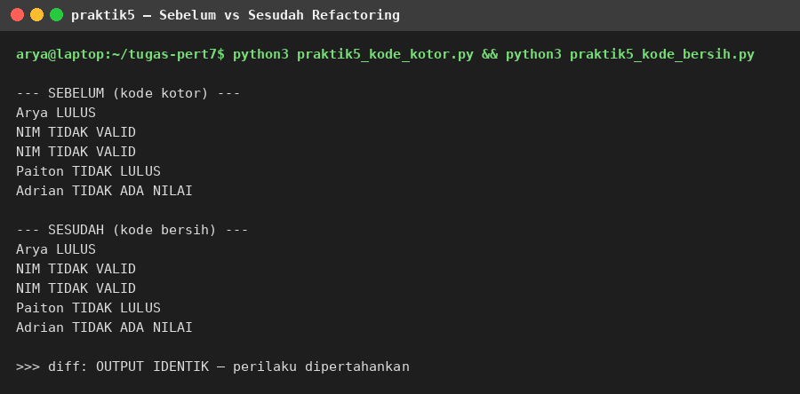
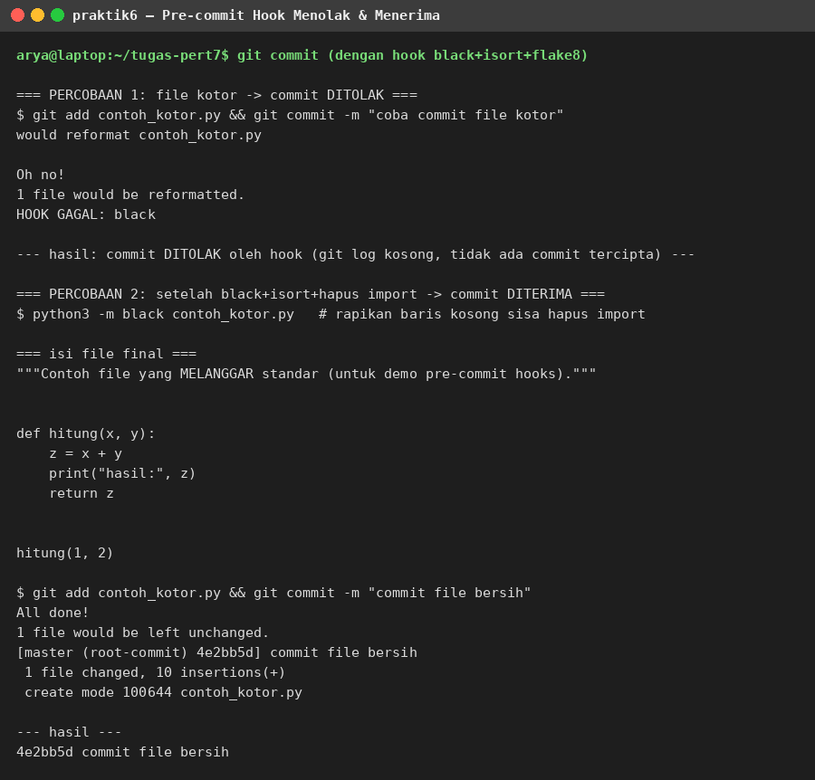

# Pertemuan 7 — Exception Handling, Debugging, Logging, Unit Testing, Clean Code, dan Code Review

**Mata kuliah:** Pemrograman Python (Program Studi Sistem Informasi)
**Nama:** Arya Adi Muhammad Iqbal
**NPM:** 20241320018

Repositori ini berisi jawaban soal teori (Bagian A) dan program soal praktik
(Bagian B) dari Modul Bahan Ajar Python Pertemuan 7.

---

## Bagian A — Jawaban Soal Teori

### A.1. Perbedaan syntax error dan exception

**Syntax error** adalah kesalahan penulisan kode yang melanggar aturan tata
bahasa Python. Kesalahan ini dideteksi oleh *parser* sebelum program dijalankan,
sehingga program tidak bisa berjalan sama sekali sampai kodenya diperbaiki.
Contoh:

```python
print("Halo"      # SyntaxError: tanda kurung tidak ditutup
```

```python
def sapa():
print("Halo")     # SyntaxError: indentasi salah
```

**Exception** adalah kesalahan yang terjadi saat program sedang berjalan
(*runtime*), padahal sintaks kodenya sudah benar. Program sudah bisa dieksekusi,
tetapi pada kondisi tertentu ia menemui keadaan yang tidak diharapkan.
Contoh:

```python
hasil = 10 / 0          # ZeroDivisionError saat dijalankan
```

```python
data = [1, 2, 3]
print(data[10])         # IndexError: indeks di luar jangkauan
```

Singkatnya: syntax error menghentikan program sebelum berjalan dan harus
diperbaiki manual, sedangkan exception terjadi saat berjalan dan bisa
ditangani dengan `try-except` agar program tetap berjalan atau berhenti
dengan pesan yang jelas.

### A.2. Perbedaan blok `else` dan `finally`

Keduanya adalah pelengkap `try-except`, tetapi dijalankan pada kondisi yang
berbeda:

- **Blok `else`** hanya dijalankan jika **tidak ada exception** yang terjadi di
  blok `try`. Fungsinya memisahkan kode "alur normal" dari kode yang berisiko
  error, misalnya menampilkan ringkasan data hanya bila pembacaan file
  berhasil.
- **Blok `finally`** **selalu dijalankan**, baik ada exception maupun tidak,
  bahkan jika exception-nya tidak tertangani. Fungsinya untuk pembersihan
  sumber daya (*resource cleanup*) yang wajib dilakukan, misalnya menutup
  koneksi database atau file.

Contoh:

```python
try:
    f = open("data.csv")
    data = f.read()
except FileNotFoundError:
    print("File tidak ada")
else:
    print("File berhasil dibaca")   # hanya bila tidak ada error
finally:
    f.close()                        # selalu ditutup, error atau tidak
```

### A.3. Mengapa urutan blok `except` penting

Exception di Python membentuk hierarki pewarisan: `Exception` adalah induk dari
`ValueError`, `TypeError`, `LookupError`, dan sebagainya. Blok `except`
diperiksa **berurutan dari atas ke bawah**, dan blok pertama yang cocok akan
menangani exception tersebut.

Jika exception yang lebih umum (misalnya `except Exception`) ditulis sebelum
yang lebih spesifik (misalnya `except ValueError`), maka blok yang umum akan
selalu "menangkap duluan" semua exception, sehingga blok yang spesifik di
bawahnya **tidak akan pernah tercapai** (*unreachable code*). Akibatnya
penanganan khusus untuk tiap jenis error menjadi sia-sia.

Aturannya: tulis exception yang **paling spesifik terlebih dahulu**, baru yang
umum di paling bawah sebagai jaring pengaman terakhir.

```python
try:
    ...
except ValueError:      # spesifik dulu
    ...
except Exception as e:  # umum paling akhir
    ...
```

### A.4. Keuntungan hierarki custom exception

Menggunakan exception bawaan secara langsung (misalnya melempar `ValueError`
untuk semua kasus) membuat kode penanganan menjadi kabur: penangkap tidak bisa
membedakan apakah error berasal dari NIM yang salah format, NIM yang duplikat,
atau error validasi lain. Keuntungan membuat hierarki custom exception:

1. **Penanganan per jenis masalah bisnis.** Tiap kondisi error punya tipe
   sendiri sehingga bisa ditangani berbeda-beda.
2. **Penangkapan bertingkat.** Menangkap induknya (misalnya `MahasiswaError`)
   akan menangkap seluruh anaknya sekaligus bila penanganan detail tidak
   diperlukan.
3. **Pesan error yang kontekstual.** Exception bisa membawa atribut tambahan
   (misalnya NIM yang bermasalah) selain pesan string.
4. **Stabil terhadap perubahan teknis.** Hierarki mencerminkan domain bisnis,
   bukan detail implementasi, sehingga tidak berubah saat teknologi diganti.

Contoh dalam Sistem Informasi Akademik:

```python
class SIAkademikError(Exception): ...
class MahasiswaError(SIAkademikError): ...
class NIMFormatError(MahasiswaError): ...
class NIMDuplikatError(MahasiswaError): ...

try:
    daftarkan_mahasiswa(data)
except NIMFormatError as e:
    print(f"Format salah: {e}")        # penanganan spesifik
except NIMDuplikatError as e:
    print(f"Duplikat: {e}")            # penanganan spesifik
except MahasiswaError as e:
    print(f"Error mahasiswa lain: {e}")  # sisanya ditangani umum
```

### A.5. Debugging dengan `print` vs `pdb`

**Print statement** adalah teknik paling sederhana: menambahkan `print()` di
titik-titik penting untuk melihat nilai variabel dan alur eksekusi.
Kelebihannya cepat dan tidak perlu alat tambahan, cocok untuk bug sederhana
yang lokasinya sudah diduga. Kekurangannya: harus mengedit kode berulang kali,
outputnya menumpuk, dan tidak bisa memeriksa state program secara interaktif.

**pdb** (Python Debugger) adalah debugger interaktif bawaan Python. Dengan
`breakpoint()`, eksekusi berhenti di titik tertentu lalu kita bisa memeriksa
variabel (`p`), mengeksekusi baris demi baris (`n`/`s`), melihat *call stack*
(`w`), dan melanjutkan (`c`). Cocok untuk bug yang kompleks atau yang
penyebabnya belum diketahui, karena kita bisa "mengintip" keadaan program
tepat saat masalah terjadi.

Kapan memakai apa: gunakan `print` untuk pemeriksaan cepat nilai variabel
pada bug yang sederhana; gunakan `pdb` (atau debugger IDE) saat bug sulit
dilacak, melibatkan banyak fungsi, atau butuh inspeksi interaktif. Di
lingkungan produksi keduanya tidak dipakai — `pdb`/`breakpoint()` tidak boleh
tertinggal di kode produksi, gunakan `logging` sebagai gantinya.

### A.6. Lima level logging standar Python

| Level | Nilai | Kapan dipakai | Contoh dalam SI |
|---|---|---|---|
| DEBUG | 10 | Informasi diagnostik detail untuk pengembang | Isi query SQL yang dijalankan |
| INFO | 20 | Konfirmasi operasi berjalan normal | "User 'arya' berhasil login" |
| WARNING | 30 | Kondisi yang berpotensi jadi masalah | "Penggunaan memori mencapai 85%" |
| ERROR | 40 | Error yang masih bisa ditangani program | "Gagal mengirim email notifikasi" |
| CRITICAL | 50 | Error fatal, sistem terancam berhenti | "Koneksi database utama terputus!" |

Level bersifat berjenjang: jika *threshold* logger diset ke WARNING, maka
hanya WARNING, ERROR, dan CRITICAL yang dicatat, sedangkan DEBUG dan INFO
disaring. Ini memungkinkan pengaturan berbeda per lingkungan, misalnya level
DEBUG di development dan INFO di production.

### A.7. Perbedaan `setUp` dan `setUpClass`

- **`setUp`** adalah method instance yang dijalankan **sebelum setiap** method
  test. Cocok untuk menyiapkan kondisi awal yang harus segar di tiap test,
  misalnya mengosongkan tabel lalu mengisi satu baris data uji.
- **`setUpClass`** adalah *classmethod* yang dijalankan **sekali saja sebelum
  seluruh** method test dalam kelas tersebut berjalan. Cocok untuk persiapan
  yang mahal dan bisa dipakai bersama, misalnya membuka koneksi database atau
  membuat file database test.

Pasangannya: `tearDown` (setelah tiap test, untuk bersih-bersih) dan
`tearDownClass` (sekali setelah semua test, misalnya menutup koneksi dan
menghapus file database test).

### A.8. Prinsip DRY

**DRY (Don't Repeat Yourself)** menyatakan bahwa setiap pengetahuan dalam
sistem harus memiliki satu representasi tunggal. Duplikasi kode berbahaya
karena perbaikan di satu salinan mudah lupa disinkronkan ke salinan lain,
sehingga bug muncul diam-diam.

Contoh pelanggaran — logika validasi NIM ditulis ulang di dua fungsi:

```python
def proses_pendaftaran(data):
    if not data['nim'].isdigit() or len(data['nim']) != 10:
        raise ValueError("NIM tidak valid")
    ...

def update_mahasiswa(data):
    if not data['nim'].isdigit() or len(data['nim']) != 10:  # duplikat!
        raise ValueError("NIM tidak valid")
    ...
```

Refactoring yang tepat — validasi dipusatkan di satu fungsi lalu dipakai ulang:

```python
def validasi_nim(nim):
    if not nim.isdigit() or len(nim) != 10:
        raise ValueError(f"NIM '{nim}' tidak valid")

def proses_pendaftaran(data):
    validasi_nim(data['nim'])
    ...

def update_mahasiswa(data):
    validasi_nim(data['nim'])
    ...
```

Kini aturan validasi hanya ada di satu tempat; jika format NIM berubah, cukup
ubah satu fungsi.

### A.9. Empat code smell umum dan refactoring-nya

1. **Magic Number** — angka mentah tanpa penjelasan, misalnya
   `if status == 3:`. Sulit dipahami dan rawan salah ubah. Refactoring:
   *Replace with Constant*, `STATUS_LULUS = 3`.
2. **Duplicate Code** — potongan kode yang sama di beberapa tempat, misalnya
   validasi yang di-copy-paste. Refactoring: *Extract Method/Class* menjadi
   satu fungsi yang dipakai ulang.
3. **Long Method** — fungsi terlalu panjang (misalnya > 20-30 baris) sehingga
   sulit dipahami. Refactoring: *Extract Method*, pecah menjadi fungsi-fungsi
   kecil yang fokus.
4. **Deep Nesting** — `if` bertingkat lebih dari 3 level. Refactoring:
   *Guard Clause* (return/continue dini untuk kasus gagal) atau *Extract
   Method* sehingga alur utama tetap datar dan mudah dibaca.

(Dua smell lain yang umum: *Dead Code* — kode tak terpakai, hapus saja; dan
*God Class* — kelas dengan terlalu banyak tanggung jawab, pecah dengan
*Extract Class*.)

### A.10. Peran static analysis tools dalam code review dan CI/CD

Static analysis tools memeriksa kode **tanpa menjalankannya**. Masing-masing
punya peran:

- **pylint** — *linting* komprehensif: potensi bug, pelanggaran konvensi,
  hingga skor kualitas kode.
- **flake8** — pemeriksaan gaya PEP 8, kompleksitas, dan masalah import.
- **black** — *auto-formatter*: merapikan format kode secara otomatis dan
  konsisten.
- **mypy** — *type checking*: memastikan penggunaan *type hints* konsisten
  sehingga salah tipe tertangkap sebelum runtime.
- **bandit** — pemindaian celah keamanan (misalnya password yang di-hardcode).

Jika tools ini diintegrasikan ke **pre-commit hook** dan **pipeline CI/CD**,
setiap commit/PR otomatis diperiksa: kode yang tidak memenuhi standar langsung
ditolak atau diperbaiki sebelum sampai ke reviewer manusia. Dampaknya, code
review menjadi jauh lebih efektif karena reviewer tidak lagi menghabiskan waktu
untuk masalah gaya/format yang bisa dideteksi mesin, melainkan fokus pada hal
yang butuh pertimbangan manusia: kebenaran logika bisnis, arsitektur, dan
keputusan desain.

---
## Bagian B — Soal Praktik

Semua program sudah dijalankan dan hasilnya terverifikasi. Tangkapan layar
terminal tiap praktik ada di folder `ss_hasil/`.

### B.1. Exception handling pembacaan CSV — `praktik1_baca_csv.py`

Membaca `data_mahasiswa.csv` dengan penanganan `FileNotFoundError`,
`csv.Error` (dibaca dengan `strict=True`), dan `ValueError`. Blok `finally`
memastikan file selalu ditutup, blok `else` menampilkan ringkasan (jumlah data,
rata-rata IPK 3.70, IPK tertinggi 3.90) hanya jika pembacaan berhasil.
Didemonstrasikan 4 skenario: file valid, file tidak ada, nilai IPK bukan angka,
dan format CSV rusak.

```bash
python3 praktik1_baca_csv.py
```



### B.2. Hierarki custom exception perpustakaan — `praktik2_perpustakaan.py`

Hierarki: `PerpustakaanError` sebagai base, dengan `BukuNotFoundError`,
`BukuTidakTersediaError`, dan `AnggotaNotFoundError`. Fungsi `pinjam_buku()`
melempar exception yang sesuai, dan program utama mendemonstrasikan 5 skenario:
peminjaman berhasil, anggota tidak terdaftar, kode buku tidak terdaftar, stok
habis, serta stok habis setelah dipinjam.

```bash
python3 praktik2_perpustakaan.py
```



### B.3. Konfigurasi logging — `praktik3_logging.py`

Logger `si_akademik` dengan dua handler: (a) `RotatingFileHandler` ke
`si_app.log` untuk level DEBUG ke atas (maks 1 MB, 2 file backup), (b)
`StreamHandler` ke konsol hanya untuk WARNING ke atas. Formatter menyertakan
timestamp, level, nama logger, dan pesan. Hasil: terminal hanya menampilkan
WARNING/ERROR/CRITICAL, sedangkan file log mencatat kelima level.

```bash
python3 praktik3_logging.py
```



### B.4. Unit test — `praktik4_unittest.py`

Test lengkap untuk `hitung_ipk()`, `validasi_nim()`, dan
`konversi_nilai_huruf()` mencakup happy path, edge case (list kosong, total SKS
nol, batas tiap huruf, nilai 0 dan 100), serta input tidak valid
(`ValueError` untuk nilai di luar 0-100, `TypeError` untuk tipe non-angka).
Hasil: **12 test, semuanya OK**.

```bash
python3 praktik4_unittest.py
```



### B.5. Code smell dan refactoring

`praktik5_kode_kotor.py` mengandung 5 code smell: magic number (10, 60, 3),
duplikasi validasi NIM, long method (±30 baris), deep nesting (5 level if),
dan dead code. `praktik5_kode_bersih.py` adalah hasil refactoring: konstanta
bernama, validasi terpusat, fungsi dipecah (`hitung_rata_rata`,
`tentukan_kelulusan`, `proses_kelulusan`), guard clause, dead code dihapus,
plus docstring dan type hints sesuai PEP 8. Output keduanya **identik**
(terverifikasi dengan `diff`), jadi perilaku program dipertahankan.

```bash
python3 praktik5_kode_kotor.py
python3 praktik5_kode_bersih.py
```



### B.6. Pre-commit hooks — `praktik6/.pre-commit-config.yaml`

Konfigurasi menjalankan **black** (auto-format), **isort** (pengurutan import),
dan **flake8** (linting, maks baris 79) otomatis sebelum setiap commit.
Demonstrasi dengan hook pre-commit asli di repo git percobaan:

1. Commit file kotor (`contoh_kotor.py`) **ditolak** hook — black menemukan
   pelanggaran format.
2. Setelah diperbaiki dengan black + isort dan import tak terpakai dihapus
   (temuan flake8), commit **diterima**.

Ini membuktikan kode yang tidak memenuhi standar tidak bisa masuk ke
repository selama hook terpasang.



---

## Struktur folder

```
.
├── README.md
├── praktik1_baca_csv.py
├── praktik2_perpustakaan.py
├── praktik3_logging.py
├── praktik4_unittest.py
├── praktik5_kode_kotor.py
├── praktik5_kode_bersih.py
├── data_mahasiswa.csv
├── data_nilai_rusak.csv
├── data_format_rusak.csv
├── praktik6/
│   ├── .pre-commit-config.yaml
│   └── contoh_kotor.py
└── ss_hasil/
    ├── ss_praktik1_csv.png
    ├── ss_praktik2_perpustakaan.png
    ├── ss_praktik3_logging.png
    ├── ss_praktik4_unittest.png
    ├── ss_praktik5_refactoring.png
    └── ss_praktik6_precommit.png
```
